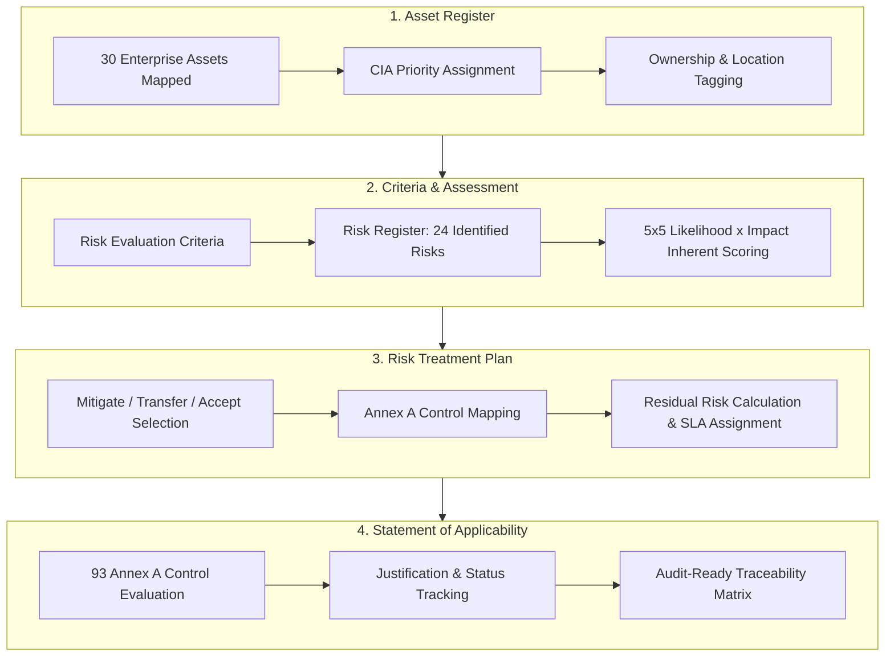
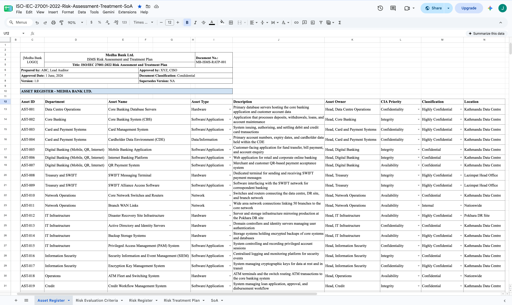
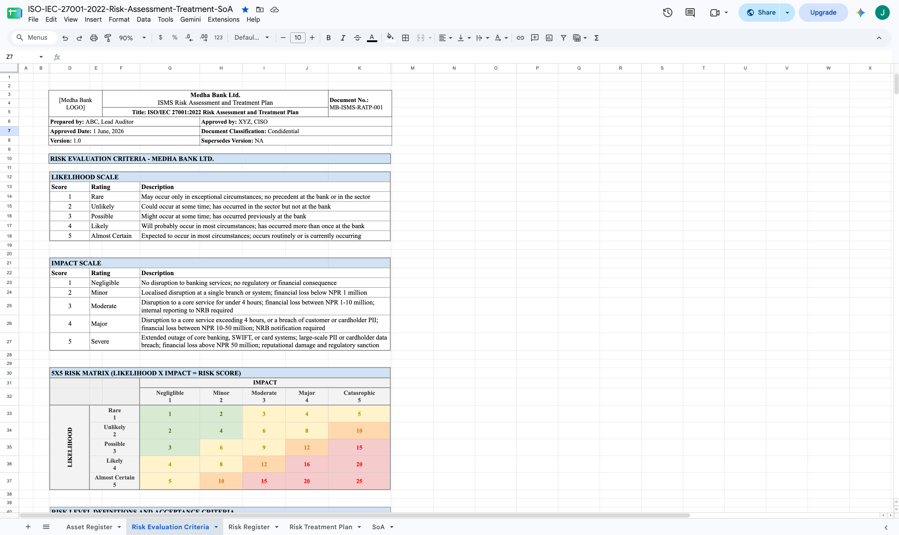
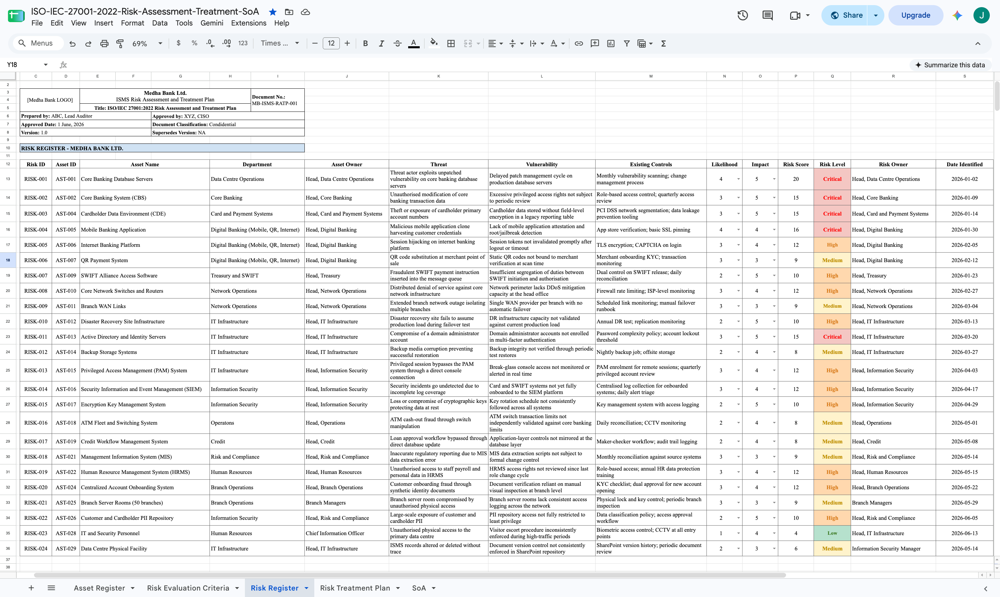
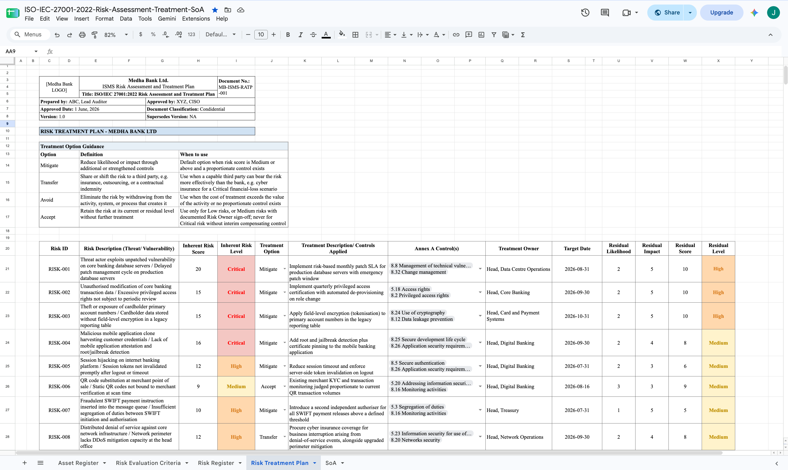
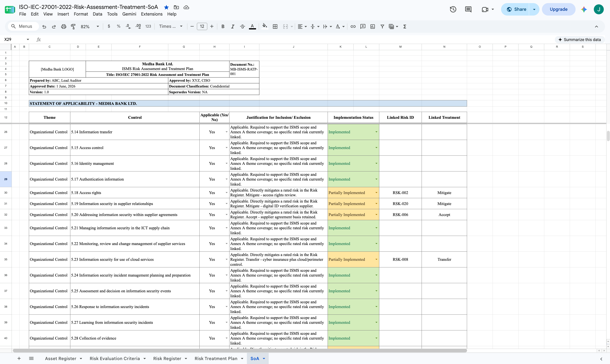

# Enterprise ISO/IEC 27001:2022 Risk Assessment, Risk Treatment & SoA Implementation

> *"In modern enterprise architecture, information security risk management is not merely a compliance burden. It is the strategic engineering behind organizational resilience and operational continuity."*

> [!NOTE]
> **Implementation Context Notice:** This repository contains a **practice implementation project** developed for a **hypothetical entity (Medha Bank Pvt. Ltd.)**. It is designed to demonstrate end-to-end GRC methodology, dynamic worksheet modeling, and ISO/IEC 27001:2022 ISMS alignment.

---

### Document Control & Governance Header

| Metadata Field | Document Attribute |
| :--- | :--- |
| **Organization Scope** | **Medha Bank Pvt. Ltd.** *(Hypothetical Commercial Bank: 1,500 Personnel, 50 Branches)* |
| **Implementation Context** | **ISMS Practice & Simulation Project** |
| **Document Reference** | `MB-ISMS-RATP-001` |
| **Classification** | **Confidential** *(Practice Artifact)* |
| **Standard Baseline** | **ISO/IEC 27001:2022** *(Clauses 6.1.2, 6.1.3, 8.2, 8.3 & Annex A Controls)* |
| **Master Google Sheet** | [**ISO-IEC-27001-2022-Risk-Assessment-and-Treatment**](https://docs.google.com/spreadsheets/d/1PPMZQVXTQhz8DKIAwHHggz9KAD7tEDyKcwcaf-pHMbA/edit?gid=1904216334#gid=1904216334) |

---

## 1. Scope & System Architecture

### Core Project Scope

* **Target Environment:** Simulated ISMS implementation scope for Medha Bank Pvt. Ltd. (Hypothetical Entity).
* **Infrastructure Coverage:** Core banking databases, digital banking platforms (Mobile, Internet, QR), payment processing environments (Card Management System & Cardholder Data Environment), SWIFT messaging infrastructure, 50-branch WAN network, and data center facilities.
* **Primary Objective:** Operationalize an enterprise-grade Information Security Risk Assessment, Risk Treatment Plan (RTP), and Statement of Applicability (SoA) using dynamic worksheets.
* **Repository Architecture:** Standalone single `README.md` supported by screenshot assets stored under the `assets/` directory.

> [!NOTE]
> **Implementation Scope Note:** All underlying evaluation datasets, dynamic matrix calculations, and control traceability registers are managed directly within live Google Sheets workbooks and mirrored here for audit review.

---

## 2. Google Sheets Sub-Sheet Navigation & Sequence Guide

Worksheets are processed in a strict logical sequence: **Asset Taxonomy → Evaluation Criteria → Threat & Risk Assessment → Treatment Execution → Control Traceability.**

| Sequence | Sub-Sheet Name | Operational Purpose & Module Scope | Direct Worksheet Access |
| :---: | :--- | :--- | :---: |
| **Tab 01** | **`Asset Register`** | Catalogs 30 core banking assets across hardware, software, data, site/facilities, network, and personnel, establishing CIA triad priorities and asset ownership. | [Open Sub-Sheet](https://docs.google.com/spreadsheets/d/1PPMZQVXTQhz8DKIAwHHggz9KAD7tEDyKcwcaf-pHMbA/edit?gid=0#gid=0) |
| **Tab 02** | **`Risk Evaluation Criteria`** | Establishes the $5 \times 5$ Likelihood (1–5) and Impact (1–5) scales, risk level definitions (Low, Medium, High, Critical), decision authorities, and review frequencies. | [Open Sub-Sheet](https://docs.google.com/spreadsheets/d/1PPMZQVXTQhz8DKIAwHHggz9KAD7tEDyKcwcaf-pHMbA/edit?gid=1498523204#gid=1498523204) |
| **Tab 03** | **`Risk Register`** | Maps 24 specific threat and vulnerability scenarios against inventoried assets, evaluating inherent risk scores and current compensating controls. | [Open Sub-Sheet](https://docs.google.com/spreadsheets/d/1PPMZQVXTQhz8DKIAwHHggz9KAD7tEDyKcwcaf-pHMbA/edit?gid=43526990#gid=43526990) |
| **Tab 04** | **`Risk Treatment Plan`** | Formulates action plans (Mitigate, Transfer, Accept), assigns Annex A controls, designates treatment owners and target completion dates, and calculates residual risk scores. | [Open Sub-Sheet](https://docs.google.com/spreadsheets/d/1PPMZQVXTQhz8DKIAwHHggz9KAD7tEDyKcwcaf-pHMbA/edit?gid=1519275738#gid=1519275738) |
| **Tab 05** | **`Statement of Applicability (SoA)`** | Evaluates all 93 ISO/IEC 27001:2022 Annex A controls, documenting applicability justifications, implementation status, and cross-references to rated risks. | [Open Sub-Sheet](https://docs.google.com/spreadsheets/d/1PPMZQVXTQhz8DKIAwHHggz9KAD7tEDyKcwcaf-pHMbA/edit?gid=1904216334#gid=1904216334) |

---

## 3. Quantitative Risk Methodology ($5 \times 5$ Matrix)

Inherent and residual risk scores are calculated using a discrete 5-point evaluation scale:

$$\text{Risk Score} = \text{Likelihood Rating } (1\text{ to }5) \times \text{Impact Rating } (1\text{ to }5) \quad [\text{Score Range: } 1 \text{ to } 25]$$

### Governance Thresholds & Escalation Pathways

* **Low (1–4):** Acceptable without further treatment. Recorded in the risk register and reviewed annually by the Risk Owner.
* **Medium (5–9):** Acceptable only with compensating controls in place or planned. Requires Risk Owner sign-off and semi-annual review.
* **High (10–14):** Unacceptable without a documented treatment plan and target date. Requires Information Security Manager approval and quarterly review.
* **Critical (15–25):** Unacceptable. Requires immediate interim controls, CISO and Board Risk Committee notification within 5 working days, and monthly review until reduced.

---

## 4. Deep-Dive Module Breakdown & Visual Evidence

### Module 01: Asset Register (`Tab 01`)

* **Taxonomy Structure:** Tracks 30 critical enterprise assets spanning 6 distinct asset classes (Hardware, Software Application, Data/Information, Network, Site/Facility, and People).
* **Granular Field Mapping:** Captures unique Asset ID (`AST-001` to `AST-030`), Department attribution, Descriptive Asset Name, Asset Type, Detailed Function Description, Designated Asset Owner, Primary CIA Triad Priority, Information Classification Level, and Physical/Cloud Location.
* **CIA Prioritization Alignment:** Formally tags primary security drivers per asset type (e.g., Confidentiality for Core Banking Database & CDE Cardholder Data; Integrity for CBS & Mobile Banking Application; Availability for Branch WAN Links & DR Infrastructure).
* **Data Classification Scheme:** Applies four explicit operational tiers: Internal, Public, Confidential, and Highly Confidential.

---

### Module 02: Risk Evaluation Criteria (`Tab 02`)

* **Likelihood Scale (1 to 5):** Establishes explicit qualitative and quantitative boundaries ranging from 1 (Rare: exceptional circumstances) to 5 (Almost Certain: routine occurrence or currently active threat).
* **Impact Scale (1 to 5):** Standardizes financial loss and operational disruption thresholds, defining 1 (Negligible: zero disruption), 3 (Moderate: NPR 1–10M loss or service outage under 4 hours), up to 5 (Severe: NPR >50M loss, core system outage >4 hours, or large-scale customer PII breach).
* **$5 \times 5$ Risk Matrix Modeling:** Constructs a $25$-point quantitative risk matrix intersecting Likelihood and Impact ratings to determine inherent risk scores.
* **Risk Acceptance Criteria & Decision Matrix:** Maps risk scores into 4 actionable governance tiers: Low (1–4), Medium (5–9), High (10–14), and Critical (15–25), assigning explicit sign-off authorities (Risk Owner, IS Manager, CISO, Board Risk Committee).

---

### Module 03: Risk Register (`Tab 03`)

* **Scenario Identification:** Documents 24 distinct threat and vulnerability scenarios (`RISK-001` through `RISK-024`) across inventoried assets, detailing threat actors, attack vectors, and operational exposure.
* **Baseline Control Mapping:** Evaluates existing compensating controls prior to treatment (e.g., existing TLS encryption, monthly vulnerability scanning, CCTV monitoring, role-based access controls).
* **Inherent Scoring Calculation:** Applies the $5 \times 5$ matrix to calculate raw inherent likelihood, impact, and overall risk scores before additional remediation.
* **Critical Risk Escalation:** Highlights top-tier critical threats requiring urgent governance escalation:
  * `RISK-001`: Core Banking Server unpatched vulnerability exploitation (Score: 20 - Critical).
  * `RISK-002`: Unauthorised modification of core banking transaction data via excessive privileged access (Score: 15 - Critical).
  * `RISK-003`: Legacy unencrypted cardholder primary account numbers in reporting tables (Score: 15 - Critical).
  * `RISK-011`: Unauthenticated domain admin access due to missing MFA (Score: 15 - Critical).

---

### Module 04: Risk Treatment Plan - RTP (`Tab 04`)

* **Treatment Decision Framework:** Applies standard ISO/IEC 27001 treatment options (Mitigate, Transfer, Accept, Avoid) across all 24 evaluated risk scenarios.
* **Control Action Plans:** Formulates explicit technical and operational remediation controls (e.g., implementing risk-based patch SLAs, tokenising PAN data, deploying root/jailbreak detection, establishing secondary WAN failover, enforcing PAM break-glass monitoring).
* **ISO/IEC 27001 Annex A Alignment:** Explicitly cross-references each treatment action to corresponding ISO/IEC 27001:2022 Annex A control numbers (e.g., Control 8.8, Control 5.24, Control 8.25, Control 5.30).
* **Accountability & Residual Risk Modeling:** Assigns dedicated Treatment Owners (Head of Operations, Head of IT Infrastructure, CISO) and target completion dates while projecting reduced residual likelihood, residual impact, and target residual risk levels ($\le 10$).

---

### Module 05: Statement of Applicability - SoA (`Tab 05`)

* **Full Annex A Coverage:** Evaluates all 93 controls outlined in ISO/IEC 27001:2022, structured across the four standard themes: Organizational Controls (37), People Controls (8), Physical Controls (14), and Technological Controls (34).
* **100% Applicability Rate:** Confirms 93 applicable controls with 0 exclusions, ensuring comprehensive baseline protection for a commercial banking environment.
* **Justification Documentation:** Provides detailed inclusion justifications for every control, distinguishing standard baseline ISMS controls from controls directly deployed to mitigate identified Risk Register scenarios.
* **Bi-Directional Traceability:** Links 27 specific controls directly back to corresponding Risk IDs (`RISK-001` through `RISK-024`) and Treatment Plan actions.
* **Implementation Status Tracking:** Categorizes current deployment progress across the organization (66 Fully Implemented, 27 Partially Implemented).

---

## 5. Technical Baseline Statistics

* **In-Scope Information Assets:** 30 *(Hardware: 8, Software Application: 11, Network: 2, Site/Facility: 3, Data/Information: 5, People: 1)*
* **Assessed Risk Scenarios:** 24 *(8 Critical, 8 High, 6 Medium, 2 Low)*
* **Annex A Controls Evaluated:** 93 Controls *(Organizational: 37, People: 8, Physical: 14, Technological: 34)*
* **Applicable Controls:** 93 Controls *(0 Exclusions)*
* **Controls Directly Linked to Risk Scenarios:** 27 Controls
* **Implementation Breakdown:** 66 Fully Implemented | 27 Partially Implemented